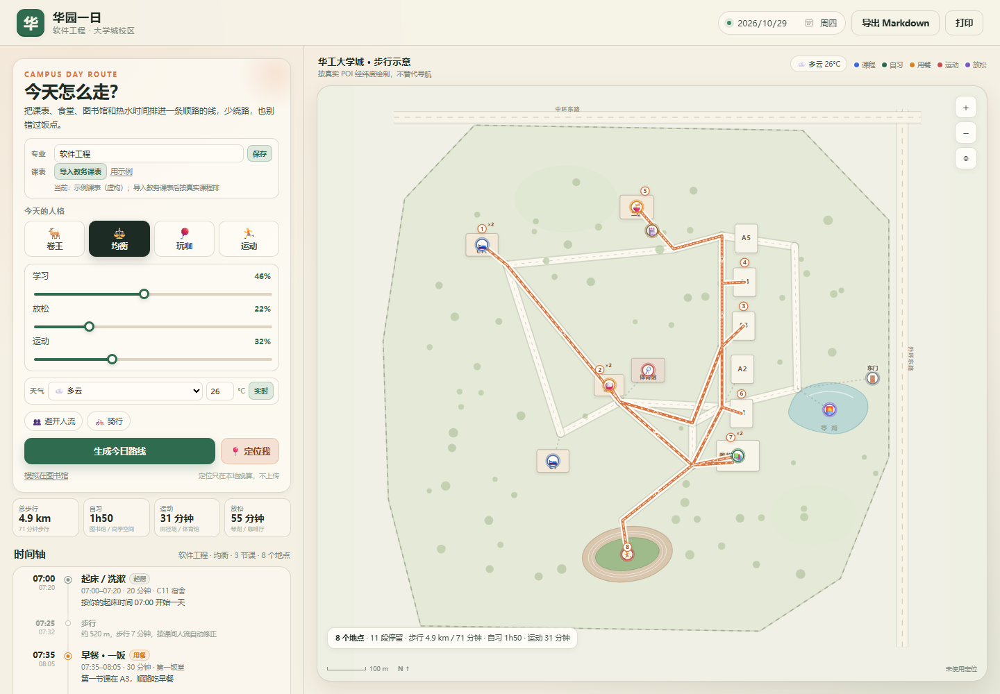
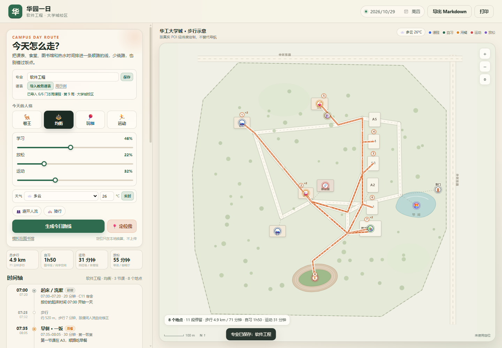
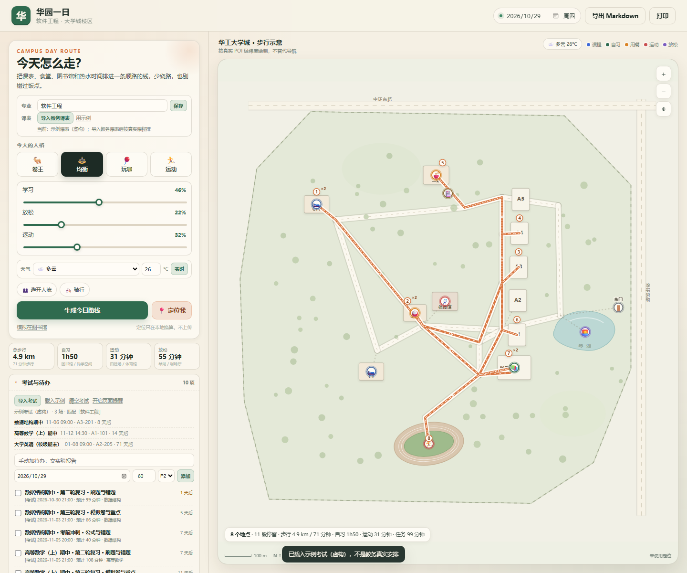

# 华园日程管家（本科生）

把华南理工大学**本科生**散落在教务系统、eCourse、雨课堂、校园门户中的课程、作业、考试与通知，统一整理成**可追溯、可修改、可解释**的日程：先把课表和任务读全，再算清占用与空闲，最后排出带原因的今日 / 未来七天 / 本周计划。

## 专家介绍

> 华园日程管家面向华南理工大学大学城校区本科生，把教务课表、eCourse 作业/测试/问卷/讨论、雨课堂待办和校园门户通知统一整理成带来源、截止时间、优先级、预计耗时与置信度的任务卡。首次使用时，它会逐步引导本人完成平台授权、作息与学习偏好设置、当前教学周确认，不索要或保存账号密码、验证码和 Cookie 明文。初始化后，它结合固定课程、个人安排、每日学习上限、连续学习时长、休息、运动和缓冲时间，生成可解释、可修改的今日、未来七天和本周计划；用户问“我现在该干什么”时，只给唯一的第一动作、后续排序和具体时段。**每个用户回合都会先确保网页驾驶舱已打开**：未初始化也进入引导模式，顶部逐项列出缺失资料，标签页和具体位置用红点提醒，并提供可复制补全指令。驾驶舱第一页采用大学城路线 UI，展示第一动作、校园地图、学习/放松/运动权重、天气、时间轴、考试待办和下一句提示；第二页展示 P0/P1/P2/P3 全部待办，第三页展示校级与学院活动，第四页是“手机工作台”，可直接启动/停止手机只读服务、换配对码、查看局域网地址、下载 APK 和排查连接。临时课程、作业、运动或休息也能写入本地覆盖层并重新排程，不改学校系统。信息读不全时明确标记“待确认”，不编造；不代交作业、不报名、不缴费、不修改学校业务数据。

## 新手推荐路径

第一次用只做一件事：**初始化**。之后三个入口就够日常使用了。

| 顺序 | 入口（专家卡快捷入口） | 负责什么 | 不负责什么 |
|---|---|---|---|
| 1 | 请告诉我你能帮我做什么，并引导我完成首次初始化 | 认识专家、完成首次初始化 | 未初始化时不直接做计划 |
| 2 | 我现在该干什么？请给出唯一的第一动作和接下来的安排 | 此刻唯一第一动作 + 后续安排 | 不重新介绍全部功能 |
| 3 | 我要临时加一门课、一项作业或一段休息，请帮我重排本周计划 | 接收临时课程 / 任务 / 运动 / 休息并重排 | 不修改学校平台数据 |

第一次召唤时，专家先说清能力、再问一句"现在开始初始化吗？"，不会一上来就抛命令或文件路径。初始化七步（账号 → 授权 → 偏好 → 登录检查 → 串行读取 → 当前教学周 → 日程分析）走完后，你会拿到一页结果：各平台读到了什么、课程几段、待办几条、哪些要人工核对、今天和本周还剩多少可用时间。

- 完整演示脚本、固定样例与预期输出：[`GOLDEN-PATH.md`](GOLDEN-PATH.md)
- 一条命令复跑黄金路径：`node golden-path\check.js`（49 项断言，离线、不用登录）

> 版本 0.12.0 新增**考试复习 + 手动待办**：按专业筛选考试安排，自动拆 T-14/T-7/T-3/T-1 复习任务；手动待办可填截止/耗时/优先级；任务会标进当天自习块，页面开着时可开启截止前 1 小时提醒。考试数据需要导入 `exams.json`；内置的考试目录是**虚构示例**，不是教务真实安排。
>
> 版本 0.13.0 将**大学城路线 UI 合入驾驶舱首页**：第一页保留地图、学习/放松/运动权重条、天气和分钟级时间轴，同时自动读取同一次驾驶舱会话里的 `jw-timetable.json`、专业偏好和主任务池；第二页“全部待办”、第三页“可参与事项”完整保留。修复组合校区标签误拒真实大学城课表、晚餐与通勤时间重叠、无参数静默使用样例、默认日期写死等问题；路线校验失败时不再输出可误用的正式计划。
>
> 版本 0.13.1 修复**课表自动生效与复制反馈**：首页会搜索最近一次历史会话中的真实 `jw-timetable.json` 并直接应用，按钮自动变为“重新导入课表”；点击后由本机驾驶舱调用教务只读脚本，缺登录才打开 Chrome，“本地文件”仅作备用。首页、待办页和活动页的复制按钮统一增加 Clipboard API 失败降级与可见成功/失败提示。
>
> 版本 0.13.2 新增**可搜索校园楼栋起点**：上课前可直接从 A1–A5、B1–B12 学院楼、图书馆、饭堂、宿舍、体育馆、计算中心、物理实验中心、礼堂、游泳馆等地点中选择“我现在在”，支持楼栋编号、中文名和学院别名包含匹配；选择后立即按该楼栋重新计算步行路线。
>
> 版本 0.13.3 修正**楼栋选择器交互与定位文案**：下拉列表只在点击选择器外部时关闭，点击列表、滚动或选项不会再误关闭；“手机定位”统一改为“设备定位”。楼栋目录补充 B 区学院楼、T3 图书馆、C1/C11 宿舍等编号别名。
>
> 版本 0.13.4 修正**全部待办完整性**：所有未完成任务都会进入 P0–P3 列表，包括延后、已过期和信息不完整项。延后任务只下降一级并保留“延后至”标记；过期任务仍单独汇总，但不会因此从全部待办消失。第一动作与即时排程仍只使用当前可执行任务。
>
> 版本 0.13.5 根据《华南理工大学大学城校区地图资料》补全**校园地点目录**：教学区 A1–A6、B1–B12，生活区 C2–C17、D1–D5、G2–G17、E1–E3，以及数字编号宿舍、学术大讲堂、国际学术中心、文溯阁、文渊阁、湖区和南操场等，共 82 个可搜索地点。B 区同时保留 2024 指引与 2026 学院官网的学院别名；生活区低置信度位置会明确标注为约值。
>
> 版本 0.13.6 修复**楼栋下拉栏随页面滚动错位**：页面或侧栏滚动时，下拉列表会实时跟随输入框重新定位；输入框滚出窗口后自动收起。
>
> 版本 0.13.7 将**三个页面标签设为吸顶导航**：今日安排、全部待办、可参与事项在页面滚动时始终固定在顶部，并适配桌面、窄屏和手机高度。
>
> 版本 0.13.8 修复**受限环境教务导入降级**：驾驶舱启动教务脚本遇到 `EPERM`/`EACCES` 时，不再只显示底层错误，而是提示 WorkBuddy 权限或系统策略原因，并提供“复制教务读取指令”入口和“本地文件”备用路径。同时把黄金路径虚构偏好 fixture 纳入仓库，保证干净克隆下 `check.js` 与 `check-v081.js` 可复现通过。
>
> 版本 0.14.0 完成团队功能整合：接入**校园生存手册知识库**、**绩点与操行分顾问**和**手机只读工作台**。手机工作台支持 PWA/APK、局域网地址、6 位配对码、配对令牌、UDP 4327 自动发现和可选公网隧道；桌面驾驶舱、大学城路线、全部待办和课表降级等既有能力保持不变。
>
> 版本 0.14.1 将**驾驶舱设为固定入口**：每个用户回合先确保外部驾驶舱打开；没有初始化数据也进入引导驾驶舱。顶部按学院、平台授权、偏好、教学周、课表、待办和活动列出缺失项，标签页红点与本页具体红点联动，每项都能复制补全指令。新增第四页“手机工作台”，可直接启动/停止、换配对码、查看地址与发现端口并下载 APK。
>
> 版本 0.14.2 修正**驾驶舱打开位置**：启动器只启动本地服务，由 Agent 调用 WorkBuddy 原生 `present_files` 在右侧内置浏览器面板打开，不再默认弹出独立 Chrome。已打开时用心跳判断并避免重复开页；只有宿主不支持内置侧边浏览器时才回退外部浏览器。手机问题会直接在侧栏定位到第四页。
>
> 版本 0.14.3 修正**侧栏打开时机**：WorkBuddy 要求 `present_files` 只能作为完成回合的最后工具调用，因此改为先启动本地驾驶舱服务、处理原请求，最后用 `present_files({"files":[URL]})` 在右侧打开；之后不再调用工具。Agent 层已禁止二次运行启动器和外部浏览器兜底。
>
> 版本 0.11.0 新增**专业入口 + 教务课表导入**：路线页面可以直接填写专业（保存在本机），并导入 `jw-timetable.json`；导入时先校验是不是大学城校区、有多少门课、当前第几周，五山课表会被拒绝。命令行用 `--major` 和 `--timetable` 对应。
>
> 版本 0.10.1 为一日路线接入**天气**：晴/多云/小雨/大雨/高温/寒冷/空气污染会改变运动与放松地点、步行时间、缓冲和提醒；页面可手动选，也可用 Open-Meteo 实时天气（无需 Key，失败自动退回手动）。只覆盖大学城校区，五山课表会被明确拒绝而不是硬套。
>
> 版本 0.10.0 新增**大学城一日路线**：按当天课表、食堂/图书馆/宿舍热水开放时间和「卷 / 玩 / 运动」权重，排出地点顺序、步行/骑行路段与分钟级日程；可选设备定位作为起点，课间人流与雨天会自动加时。只覆盖大学城校区，五山课表会被明确拒绝而不是硬套。
>
> 版本 0.9.0 新增**校园活动信息流**：初始化询问用户所在学院，内置 42 个本科相关学院/书院官网入口；抓取校级来源后，自动发现所选学院的通知、学生工作、团学、活动、竞赛和讲座栏目。活动页分别展示“校级”和“我的学院”，可直接刷新或发送“刷新校园活动”。公众号和班级群消息标为用户补充来源，不伪装成自动抓取。
>
> 版本 0.8.3 改为**任务连续优先，休息后补**：课程等硬占用之后，先把明确任务按完整预计耗时排进去，再把每日休息配额放进剩余时间；不再让固定的偏好休息时刻把 45 分钟任务切成无意义的 38+7 分钟。只有连续窗口确实放不下长任务时才拆段。
>
> 版本 0.8.2 为网页驾驶舱新增独立 `/todo.html` 待办页：按 P0/P1/P2/P3 分组显示全部任务、已过期项和数据提醒，并固定提示每 7 天发送一次“刷新我的校园待办”。今日安排页与待办页可互相切换；复制指令后在左侧对话执行，网页不会自动发送。
>
> 版本 0.8.1 改为**任务优先的即时排程**：当前有明确任务且可用时间不少于 10 分钟时直接开始；任务按预计耗时切片，可跨多个空档，也可在一个空档里连续安排多个短任务；标题明确但截止未知的任务会保守排入并标“待确认”；有任务时不再生成“自由学习（未绑定任务）”。新增 `golden-path\check-v081.js` 7 项回归。
>
> 版本 0.8.0 是**性能精简版**：主 Agent 提示词与浏览器 Skill 从约 34KB 分别压缩到约 10KB 和 7KB；普通问答不自动加载 Widget；明确区分“看驾驶舱”的内嵌卡片与“打开驾驶舱”的外部网页；`maxTurns` 从 60 降到 30。所有安全边界、eCourse 讨论区修复、黄金路径和历史能力继续保留。
>
> 版本 0.7.2 明确区分两种可视化：用户说“看驾驶舱 / 在对话里看驾驶舱”时使用 `show_widget` 内嵌卡片；说“打开驾驶舱 / 打开网页驾驶舱 / 打开分屏”时必须启动外部浏览器驾驶舱，不能误走卡片。两条路径互斥。
>
> 版本 0.7.1 修复 eCourse 讨论区误报：普通发帖、浏览数和回复按钮不再被算作“未解析作业”；只有页面明确要求回复、跟帖计分或存在回帖截止时，才保留为待确认任务。讨论区记录会单独计入 `informational`，不计入待办和 `READ_PARTIAL` 差额。
>
> 版本 0.7.0 新增**分屏网页驾驶舱**：专家可按需启动本机只读网页，并在系统浏览器中打开；左侧继续使用 WorkBuddy 对话，右侧实时展示第一动作、时间轴、待确认数据和下一步可复制指令。网页不提供聊天输入、不修改学校数据。此前 0.6.1 的扁平化 Widget 与全部能力保持不变。
>
> 版本 0.6.1 起驾驶舱 Widget 按 WorkBuddy 规范改为**扁平、无渐变和阴影、最小字号 11px、外层透明、兼容深色主题**。回归：`node golden-path\check-v060.js`（32 项）、`node golden-path\check-widget.js`（32 项）。
>
> 版本 0.6.0 起**不再替你做决定，也不再长篇大论**：① 每条数据都带来源标签（`[课程] / [平台任务] / [用户偏好] / [用户临时事项] / [系统默认] / [待确认]`），偏好记录出处与确认状态，只有"你明确说过且已确认"的才是不可移动事项；来源不明的旧固定事项（例如历史「班会」）会被标成 `[待确认]` 并只问一次"保留、修改还是删除"，首次初始化也不会再静默生成成套偏好。② 教学周未确认、平台只读到一部分、偏好仍是系统默认、任务标题或截止时间不明时，**只给估算与一个下一步**，不再输出"已自动调整 N 条""本周已排入 N 分钟"这类确定结论。③ 默认回答压缩成「结论 + 1–3 条依据 + 一个下一步」，不超过 300 字，一次只问一个问题；说"看时间轴"走 `skills/timeline-brief`（≤8 行纯文本），说"看驾驶舱"走 `skills/huayuan-dashboard-widget`（对话内紧凑卡片，不启服务器）。
> 版本 0.5.1 起 eCourse 初始化不再白屏等待：不再重复打开登录页（只在必要时导航一次），删掉固定 8 秒等待改为事件驱动轮询（二维码出现即返回，实测 0.6 秒），窗口一出现就显示顶部进度条，脚本输出逐行转发并每 3 秒给一次心跳。回归：`node golden-path\check-ecourse-ux.js`（36 项）。
> 版本 0.5.0 起**入口按新手重排**：专家卡固定三个快捷入口（先初始化 → 我现在该干什么 → 临时新增并重排），`defaultInitPrompt` 与第一条入口完全一致；新增固定开场白（`intro.js`），**未初始化时不运行 `now.js`**（它自己也会拒绝并以退出码 3 结束，不写产物）；固定黄金路径成为演示与发版回归基线（`golden-path/check.js`）。另：距下一件事不足 15 分钟时，第一动作改为"先去上课（14:30-16:10）"，不再给"做点轻量的事"；平台自己给了预计耗时时直接采用，不再一律按类型估。
> 版本 0.4.1 起**学校课表按当前教学周过滤**：`weeks.list` / `weeks.parity` 参与判定，第 14 周只排「智能配送管理」，3-12 周的课不会被排进来；教学周未知时保留课程但明确标注"周次未确认，按可能发生计入"，不宣称精确。初始化新增「当前教学周」一步：能按教务校历自动识别就直接用，识别不出来只问一次并存进状态层。
> 版本 0.4.0 起支持**「我现在该干什么」**：以当前时刻算出"唯一第一动作 + 排序待办 + 后续时段"，说清现在是否在课上、这个空档够不够。
> 0.4.0 同时引入**用户修正覆盖层**：手工课程 / 停课 / 临时任务 / 个人事项，以及平台任务（雨课堂、eCourse）的"完成 / 延后"本地状态，都不改写学校原始课表。
> 版本 0.3.2 起**固定本科生口径**，不再询问"本科还是研究生"；旧配置里残留的研究生选项会在首次运行时自动迁移，无需手动改文件。
> 同版本起**会话按平台隔离**：门户+教务 / eCourse / 雨课堂 各用一份浏览器会话，这是消除"两个平台互相抢标签"的根因。
> 同一版本起为**可移植包**：同一个包发给任意 Windows 用户，安装后本人首次登录即可读取自己的信息。包内不含任何本机用户名、课程 ID、学期码或固定输出路径。

## 类型

Agent 型（单个 AI 专家）

## 核心能力

1. **首次初始化向导**：匿名账号槽位 → 逐平台检查登录 → 采集作息与偏好 → 读取 → 确认当前教学周 → 分析，七步一次走完
2. **教务课表真实读取**：语义点击「信息查询 → 个人课表查询」，网络响应优先、DOM 表格兜底，输出学期 / 课程 / 教师 / 星期 / 节次 / 起止时间 / 周次 / 教室 / 校区
3. **可解释日程分析**：当前占用 → 空闲窗口 → 推荐休息与作业时段 → 冲突与待确认分离，每条结论都带"因为…所以…"
4. **跨平台去重合并**：合并重复任务并保留全部来源，证据不足时保留两条并提示确认，**只合并标记、不删条目**
5. **不说假话**：没读到就说"未读到"，读到 0 条才说"没有"，读不全就标"不确定"，绝不伪造 0 待办
6. **大学城一日路线**：按课表、食堂/图书馆/热水开放时间和卷/玩/运动权重，排出地点顺序、步行/骑行路段与分钟级日程；支持专业入口、教务课表/考试导入、自动复习任务、手动待办、楼栋搜索起点、设备定位起点、天气与课间人流修正（雨天/高温/污染自动改室内）

## 新用户上手

```powershell
# 一条命令走完：建槽位 → 查登录 → 采偏好 → 逐平台登录 → 读课表与任务 → 出分析 → 结果页
node skills\huayuan-browser-session\scripts\first-run.js --wizard --login
```

向导只问一次：`检测到 X 平台未登录，是否开始逐平台登录？` 确认后严格串行执行 `campus-sync → jw-timetable → ecourse-pull → rain-fast`，**每一步等浏览器关闭后才启动下一步**，同一时间只有一个活动标签，不抢前台。雨课堂只要授权且登录有效就一定会跑，不会被"数据量大"跳过。

结束时打印一页**结果页**（同目录 `onboarding-summary.md`）：各平台登录/读取状态、课程段数、待办条数与来源、今天与本周可用时段、建议休息与作业时段、需确认项、冲突与自动调整数、`check_plan` 结论。

只想做单步时：

```powershell
node skills\huayuan-browser-session\scripts\first-run.js            # 只建配置与槽位
node skills\huayuan-browser-session\scripts\session-probe.js --platform all   # 只查登录态，不弹窗
node skills\huayuan-browser-session\scripts\jw-timetable.js          # 只读教务课表
node skills\huayuan-browser-session\scripts\ecourse-pull.js          # 只读 eCourse 未完成项
node skills\huayuan-browser-session\scripts\schedule-analyze.js      # 只用已有产物出分析
```

第一次运行到需要登录时，脚本会输出 `AUTH_WAIT:<平台>` 并打开一个**非全屏**专用 Chrome 窗口，**请本人在窗口里完成统一认证或扫码**，登录成功后不要关窗，脚本会自动继续。

> 教务系统（正方 jwglxt）通常需要**二次认证**（微信企业号 / 短信验证码），脚本无法代替本人完成。无头检查会如实返回 `AUTH_REQUIRED:jw`，请在弹出的窗口里操作一次。

### 数据放在哪

| 内容 | 位置 | 说明 |
|---|---|---|
| 匿名配置 | `%USERPROFILE%\.workbuddy\huayuan-schedule-butler\config.json` | 学生类型 / 授权平台 / 槽位名，无身份信息 |
| 个人偏好 | `%USERPROFILE%\.workbuddy\huayuan-schedule-butler\preferences.json` | 作息、用餐、运动、固定事项、学习上限 |
| 账号槽位 | `%USERPROFILE%\.workbuddy\huayuan-schedule-butler\profiles\<profile-id>\` | 只放浏览器会话 |
| 会话命名空间 | 同上 `\cas` / `\ecourse` / `\rain` | 每个平台一份独立会话，互不共享 Cookie |
| 运行产物 | 当前工作区 `huayuan-output\<时间戳>\` | 每次运行独立目录 |

`HUAYUAN_HOME`、`HUAYUAN_OUTPUT_DIR` 可整体重定向上述两个根目录。

## 初始化向导（七步）

| 阶段 | 做什么 | 产物 |
|---|---|---|
| 1/7 账号 | 生成/复用匿名 `profile-id`，不采集任何身份信息 | `config.json` |
| 2/7 授权 | 确认授权平台（默认四平台），只读不写 | 配置项 |
| 3/7 偏好 | 采集起床/睡觉、三餐、运动、休息、固定事项、每日学习上限、缓冲、周末安排 | `preferences.json` |
| 4/7 检查 | 逐平台检查登录态（各用各的会话命名空间，无头、不弹窗），只问一次是否开始登录 | `all-session-probe.json` |
| 5/7 读取 | campus-sync → jw-timetable → ecourse-pull → rain-fast（串行，单标签，一步关窗再下一步） | `jw-timetable.json`、`ecourse-tasks.json`、`rain-fast.json` |
| 6/7 教学周 | 优先按教务校历自动识别并写入 `user-state.json`；识别不出来只问一次，再用 `manage-items.js set-week --number N` 保存 | 状态层 `current_week` |
| 7/7 分析 | 合并三个来源，按当前教学周过滤学校课表，算占用、空闲、推荐时段、冲突、自动调整、待确认，并跑 `check_plan` | `schedule-analysis.json/.md`、`plan.json` |

每次结束都会写 `onboarding-report.json`（含 `result_page`）与 `onboarding-summary.md`；暂停在本人的二次认证上时同样会写，标 `status: paused`。

### 初始化状态只有三态

| 状态 | 判定 | 结果页 |
|---|---|---|
| `completed` | 教务课表 / eCourse / 雨课堂 都读到，教务课程段数 > 0，分析可用且 `check_plan` 通过 | 已完成 |
| `partial` | 任一关键来源没读到、只读到一部分、教务没解析出课程、或校验未通过 | 部分完成 + 列出还差什么 |
| `paused` | 中途需要本人登录/二次认证，已停下 | 已暂停 + 唯一恢复命令 |

状态会持久到 `config.json`：`setup_state`、`setup_completed_at`、`last_onboarding_report`、`setup_detail`。专家首次对话先读它，**只引导一次初始化**，老用户不会每次重走问答。

**课表未知时不会假装有数据**：`timetable_known=false` 时结果页在数字之前声明"课表未知，空闲时间只是基于偏好的估算，不能当最终计划"，`plan.json` 写 `usable_as_plan:false`；课程数显示为"未知"而不是 0，待办在两条来源都没读到时也显示"未知"而不是 0。

今天/本周只用**现在之后**的时间：过去的日期只保留为历史占用，不再排任务或推荐休息；休息按目标分钟数补足（默认 60 分钟/天），排不下时给出差额与原因。

想改偏好不必重新登录：直接告诉智能体新的作息/上限/运动时间，重跑 `schedule-analyze.js` 即可。

WorkBuddy 等非 TTY 环境用这一条（不依赖交互输入）：

```powershell
node skills\huayuan-browser-session\scripts\first-run.js --wizard --yes --prefs prefs.json --login-timeout-seconds 600
```

## 切换账号 / 多账号

同一台电脑上换另一个学校账号时，**必须换一个 `--profile-id`**：

```powershell
node skills\huayuan-browser-session\scripts\first-run.js --profile-id acc-b --yes
node skills\huayuan-browser-session\scripts\jw-timetable.js --profile-id acc-b
```

- 共用同一个槽位 = 两个账号的 Cookie 互相覆盖 = 可能读到别人的数据或登录态反复失效。
- 槽位之间完全隔离，`first-run.js --show` 会列出本机已有槽位与迁移记录。
- 输出里出现 `PROFILE_ID_OVERRIDE` 时，说明本次命令行槽位与配置不一致，先确认是不是自己有意切换。

## 内置技能 huayuan-browser-session

所有需要统一认证的读取统一经过会话网关：

- 先无头检查登录态，正常时不显示浏览器
- 仅在登录失效时打开**一次**专用 Chrome 窗口（1280×860，不最大化、不全屏），并暂停等待用户本人登录
- 登录成功后不关窗，立即在同一会话中读取
- 读取完成或等待超时后自动关闭
- 不保存、打印或导出 Cookie、Token、票据及动态认证请求头

### 单标签纪律

登录等待和读取阶段**只保留一个活动标签**：

- 不开探测页抢前台（开探测页会触发 CAS 重定向风暴，也容易触发风控）
- 门户、教务在同一标签内顺序导航
- `src` 为空的 iframe 是占位元素，单独计数但**不阻断**读取
- **eCourse 的主框架只允许停留在 `ecourse` 与 `sso`**：顶层一旦进入教务（`xsjw` / `jwglxt`）立即中止整次读取并记录脱敏 URL（`ECOURSE_TOP_REDIRECTED_TO_JW`）；进入其他站点同样中止（`ECOURSE_TOP_LEFT_PLATFORM`）。中止后不再导航、不在 eCourse 会话里打开门户或教务

### 会话命名空间（0.3.2 起）

同一槽位下按平台分目录，**互不共享 Cookie**：

| 命名空间 | 平台 | 位置 |
|---|---|---|
| `cas` | 校园门户 + 教务系统 | `profiles\<profile-id>\cas` |
| `ecourse` | eCourse | `profiles\<profile-id>\ecourse` |
| `rain` | 雨课堂 | `profiles\<profile-id>\rain` |

- 脚本只需传 `--profile-id`，具体目录由 `session-gateway.js` 按 `platform` 选择
- **同一时刻仍然只允许一个 Chrome**：命名空间不同不等于可以并行，数据根目录的 `.browser-singleton.lock` 会让第二个进程得到 `BROWSER_BUSY`
- **继承规则收窄（0.3.2）**：只有 `cas` 首次建目录时继承旧共享会话；`ecourse` 与 `rain` 从空目录开始、需要各自登录一次。旧共享目录里留着跨站 Cookie / 本地存储，整份复制会让 eCourse 顶层仍被带偏。首次建立会写入 `notice` 并在结果页展示，不静默

### 脚本分工

| 脚本 | 职责 | 主要产物 |
|---|---|---|
| `intro.js` | 按初始化状态给出**固定开场白**（未初始化 / 部分完成 / 已完成三种），决定第一句话说什么 | 终端输出（`INTRO_STATE` / `INTRO_TEXT`） |
| `first-run.js` | 首次配置 + 初始化向导（`--wizard`） | `config.json`、槽位目录 |
| `session-probe.js` | 只检查登录态，绝不弹窗 | `all-session-probe.json` |
| `campus-sync.js` | **只做校园门户 + 教务** 的单标签读取 | `campus-sync.json`、`campus-sync-session-summary.json` |
| `jw-timetable.js` | 教务课表读取（HTTP → 网络响应 → DOM） | `jw-timetable.json/.md`、`jw-timetable-raw.json` |
| `ecourse-pull.js` | **只做 eCourse** 课程枚举 + 课堂未完成项 | `ecourse-courses.json`、`ecourse-tasks.json` |
| `rain-fast.js` | 雨课堂待办批量读取 | `rain-fast.json`、`rain-fast-result.md` |
| `schedule-analyze.js` | 占用 / 空闲 / 推荐 / 冲突 / 计划骨架 | `schedule-analysis.json/.md`、`plan.json` |
| `manage-items.js` | 用户修正：加课 / 停课 / 加任务 / 完成 / 延后 / 删除 / 列表 | `user-overrides.json`、`user-state.json` |
| `now.js` | 现在该干什么：当前占用 / 可用窗口 / 唯一第一动作 / 排序待办 / 后续时段 | `now.json`、`now.md` |

`campus-sync` 与 `ecourse-pull` **职责不重叠**，这是修复"两个平台互抢标签"的关键：门户+教务归 campus-sync，eCourse 归 ecourse-pull。

黄金路径回归脚本在包根目录：`node golden-path\check.js`（七步 47 项断言，离线、不登录、不联网；样例在 `golden-path\fixtures\`，全部虚构）。

公共参数：

```
--profile-id <槽位>        匿名账号槽位（默认 default）
--output-dir <目录>        产物目录（默认 huayuan-output/<时间戳>）
--login-timeout-seconds N  可见登录等待上限
```

### 教务课表读取

```powershell
node skills\huayuan-browser-session\scripts\jw-timetable.js
```

读取顺序是**三级降级**，每一级都记录在 `extraction` 里：

1. `http-replay` — 在已登录页面内重放课表请求（credentials: include）
2. `network-json` — 监听页面自己发出的课表请求，解析 JSON 响应
3. `dom-table` — 解析 `#kblist_table`（列表视图）或 `#kbgrid_table_0`（表格视图）

关键实现点：

- 教务菜单是 `target="_blank"`，点击后**在新标签打开**，脚本会接管这个新标签再解析；只解析原页面会得到空结果
- 列表视图第 0 行是"姓名 + 学号"标题行，**跳过且不落盘**
- 表格视图的星期要用表头单元格水平中心对齐，避免 rowspan 列导致整体错位
- 学期由隐藏域 `#xnm` / `#xqm` 识别，识别不到再退回正文正则
- 校区（五山 / 大学城 / 广州国际）决定用哪套**官方节次时间**换算起止时间，换算依据写进 `time_note`
- 未识别出的字段进 `pending_fields`，不猜

### eCourse 读取约定

```powershell
node skills\huayuan-browser-session\scripts\ecourse-pull.js --login-timeout-seconds 600
```

- 只从根地址 `https://ecourse.scut.edu.cn/` 进入并**跟随 302**，不拼接、不直接访问无 id 的 `index.html`
- 课程全部**动态枚举**，不写死课程 id
- 产物：
  - `ecourse-courses.json` — 门户枚举出的全部课程（`course_id`、课程页 URL、来源 dom/json）
  - `ecourse-tasks.json` — 逐门进入「教学课堂」按作业 / 测试 / 问卷 / 讨论读取，**只保留未完成项**，每门每分类附 `records_total / submitted_count / unfinished_count / unknown_count / unparsed_count`
  - `ecourse-discovery.json` — 枚举诊断（锚点、iframe、捕获到的接口 URL），识别不到课程时用于定位选择器
- 解析约定：含「已提交 / 已完成 / 已作答」判为完成；只有「未提交 / 未完成 / 未作答 / 去提交」判为待办；「已过期」仅表示过期，不等于未提交；列表 `记录总数=0` 直接返回空结构，不保留表头或日期碎片
- **差额核对**：页面声明"共 N 条"但只解析出 M 行时，N−M 会记为 `unparsed_count` 并计入 `unknown`，整体状态降为 `partial`，同时给出 `notes` 提示人工核对。**这种情况下不会宣称"没有待办"**
- 已知坑：门户 `index.html?id=...` 会预置多个 `src` 与自身同址的**空占位 iframe**，`ECOURSE_SELF_EMBED_LOOP` 仅作告警上报，**不能当作"未登录"证据，也不阻断导航**

### 日程分析

```powershell
node skills\huayuan-browser-session\scripts\schedule-analyze.js
```

- 自动找最新的 `huayuan-output/*/jw-timetable.json` 与 `ecourse-tasks.json`，也可用 `--timetable` / `--tasks` 指定
- 产出三件事：`schedule-analysis.json`（结构化）、`schedule-analysis.md`（给人看）、`plan.json`（可校验的计划骨架）
- **冲突（`conflicts`）与自动调整（`adjustments`）分开**：需要用户决定的才叫冲突，已经自动处理好的只作告知
- 自动调整的三条规则：
  - 用餐撞课程 → 顺延到课后（或提前到课前），取改动最小且不撞其他块的方案
  - 运动撞课程/用餐 → 同样让位，并说明因为谁让位
  - 都挪不开才升级为 `meal_clash` / `exercise_clash` 冲突
- **周次感知**：`19:00-20:40（第14周）` 与 `19:00-21:35（4-13周）` 时间重叠但周次不相交，不算冲突；`plan.json` 里的块带上 `weeks` / `week_list`，`check_plan.py` 同样会跳过
- 默认就对 `plan.json` 跑一次硬约束校验并把结果写进 `validation`，`--no-validate` 可关

### 雨课堂学期识别

```powershell
node skills\huayuan-browser-session\scripts\rain-fast.js
```

学期码**不写死**：默认从本人课程数据里按「课程数最多的学期，并列取较大者」识别当前学期，并把依据写进 `rain-fast.json`：

```json
"term_detection": {
  "mode": "auto",
  "chosen": "<学期码>",
  "rule": "取本人课程数据中课程数最多的学期；数量并列时取学期码较大者",
  "source": "雨课堂 user-courses 返回的 product_list[].classroom_term",
  "evidence": [{ "term": "<学期码>", "course_count": 5 }]
}
```

识别不对时用 `--term <学期码>` 覆盖，输出会标 `mode: explicit`。

## 内置技能 huayuan-task-card

- `references/source-platforms.md` — 平台实测要点、支持矩阵、故障排查与降级读取路径
- `references/task-card-schema.md` — 任务卡字段定义与正反示例
- `references/load-baseline.md` — 各类任务耗时基线与缓冲规则
- `scripts/check_plan.py` — 排程硬约束校验（重叠 / 超负荷 / 晚于截止 / 缓冲），可直接运行：

```bash
python skills/huayuan-task-card/scripts/check_plan.py --demo
```

## 内置技能 timeline-brief

只在你问"今天的时间轴 / 看一下今天安排"时调用，输出**纯文本**，不画图、不调大模型：

```bash
node skills/timeline-brief/scripts/timeline-brief.js --now <输出目录>\now.json --hours 6
node skills/timeline-brief/scripts/timeline-brief.js --self-check    # 10 项自检
```

- 默认窗口：现在 + 未来 6 小时，最多 8 行，每行 `时间 | 事项 | 来源 | 状态`
- 来源标签只用 `[课程] / [任务] / [偏好] / [临时] / [待确认]`
- 数据是估算口径时，开头先写"（数据未确认，以下为估算）"
- 读取进行中、未初始化时不调用

## 内置技能 huayuan-dashboard-widget

把 `now.json` 渲染成对话内的**紧凑驾驶舱卡片**（日期时间 + 唯一第一动作 + 接下来最多 3 段 + 待确认条数 + 一行修改提示）：

```bash
node skills/huayuan-dashboard-widget/scripts/build-widget.js --now <输出目录>\now.json --plan <输出目录>\plan.json
node skills/huayuan-dashboard-widget/scripts/build-widget.js --now <输出目录>\now.json --text   # 文字降级
node skills/huayuan-dashboard-widget/scripts/build-widget.js --self-check                      # 10 项自检
```

脚本输出 `title / widget_code / loading_messages / text_fallback / meta`，由 Agent 直接传给 WorkBuddy 原生 `show_widget`。**不启动本地服务器、不落地 HTML 文件、不引外部脚本、不调网络**；`show_widget` 失败时降级成一条"第一动作 + 下一步"文字。侧边网页驾驶舱在每个用户回合开始时已经确保打开；只有用户明确说“在对话里看卡片 / 看卡片”时才额外生成内嵌卡片，它不能替代侧边驾驶舱。

## 内置技能 huayuan-campus-route

按**当天课表**和**大学城校区开放时间**排一条能走通的一日路线，回答“今天怎么走 / 上完课顺路去哪个饭堂 / 图书馆闭馆前怎么安排”：



填入专业并导入 `jw-timetable.json` 后，顶部会显示课程数与教学周（下图为示例数据）：



考试与待办：导入考试后自动拆复习任务，也可以手动加待办（下图为虚构示例考试）：



```bash
node skills/huayuan-campus-route/scripts/day-route.js --demo --date 2026-10-29 --preset balanced
node skills/huayuan-campus-route/scripts/day-route.js --timetable <输出目录>\jw-timetable.json --major 软件工程 --preset sport
node skills/huayuan-campus-route/scripts/day-route.js --demo --major 软件工程 --exams exams.json
node skills/huayuan-campus-route/scripts/day-route.js --demo --tasks tasks.json
node skills/huayuan-campus-route/scripts/day-route.js --demo --weather rain --temp 23 --mode bike --traffic peak
node skills/huayuan-campus-route/scripts/day-route.js --demo --weather heat --temp 35
node skills/huayuan-campus-route/scripts/day-route.js --demo --gps 23.0469,113.4054,wgs84
node skills/huayuan-campus-route/test/check-route.js
```

- **专业入口**：页面顶部填“专业”，保存在本机 `localStorage`；命令行用 `--major 软件工程`；专家里用 `manage-items.js set-major --name 软件工程`。专业只用于展示和日程上下文，不改变教务读取。
- **从教务导入课表**：先在助手里完成初始化/读取教务，拿到 `jw-timetable.json`；页面点“导入教务课表”选择该文件。导入时会校验：是不是大学城、几门课、有没有缺时间、当前第几周；五山/广州国际校区会拒绝。
- **考试复习与待办**：展开“考试与待办”，导入 `exams.json` 或载入**虚构示例**；按专业筛选考试，自动拆 T-14/T-7/T-3/T-1 复习任务。手动待办填截止、预计分钟、优先级；任务会标进当天自习块。页面开着时可开启截止前 1 小时提醒。真实考试安排需要导入，内置示例不是教务真实数据。
- 四个画像：卷王 / 均衡 / 玩咖 / 运动；也可以用 `--study/--play/--sport` 自定义权重。
- 固定课程不动；早餐/午餐/晚餐按下一节课就近选一饭或二饭；自习进图书馆（07:30–23:00）或 C11 尚学空间；运动进田径场/体育馆；洗澡卡在热水 12:00–14:00、17:00–00:00，并在门禁前回宿舍。
- **天气会改路线**：小雨/大雨把运动改体育馆、放松改咖啡厅/尚学空间，步行时间按天气系数加时；高温/污染取消露天跑步；寒冷加热身提醒；并给出带伞、防晒、口罩等提示。页面可选天气，也可点“实时”用 Open-Meteo 获取（无需 Key，失败自动保留手动天气；URL 加 `?live=1` 可自动取）。
- 每段路算步行/骑行时间，课间人流、天气、高峰会加时；产物 `day-route.json` / `day-route.md` 带每段依据、开放时间校验和天气说明。
- 可视化页面 `skills/huayuan-campus-route/public/index.html`，**不用起服务器**，双击即可：切画像、拖权重、选天气、开骑行、导入课表/考试、加待办、点“定位我”或“模拟在图书馆”、导出 Markdown。
- 只覆盖**大学城校区**；读到五山/广州国际校区会返回 `CAMPUS_UNSUPPORTED`，不硬套。图书馆、热水、门禁为官方来源；饭堂/体育馆时段是参考值，页面标“以现场为准”。
- 设备定位只在用户点击后读取，浏览器本地换算 WGS-84 → GCJ-02，不上传；被拒绝或超时会明确提示。地图是按真实 POI 经纬度绘制的**示意图**，不是导航底图，不接实时路况 API。
- 20 项扩展逐条状态、复用点与建议下一步：[`docs/ROADMAP-20.md`](docs/ROADMAP-20.md)。
- 完整使用说明（页面按钮、CLI 参数、常见问题）：[`skills/huayuan-campus-route/USAGE.md`](skills/huayuan-campus-route/USAGE.md)。

## 内置技能 huayuan-campus-manual（校园手册知识库）

回答作息与节次、校巴、食堂、校区地图、学业规则、就医医保、竞赛、毕业去向和新生入门等非实时校园生活问题。技能先从 `knowledge/000-知识库索引.md` 定位资料；具体数字和时效规则标注“手册数据，以官方最新通知为准”。当前产品只向用户展示大学城相关内容，五山和广州国际资料不进入路线及主流程。

## 内置技能 huayuan-score-advisor（绩点与操行分）

提供百分制平均学分绩点、四分制 GPA、学位条件检查、目标分反推，以及综合测评中的 X/C/D/Z/T/M/L/S/H 与操行分测算。计算全部在本机完成，样例均为虚构数据；校级规则与学院细则不一致时以学院最新细则为准，缺少课程排名时不会伪造四分制结果。

## 内置技能 huayuan-mobile-remote（手机工作台）

电脑驾驶舱第四页“手机工作台”提供完整引导与控制：启动/停止手机服务、换 6 位配对码、显示局域网地址和 UDP `4327` 发现端口、下载随包 APK、复制手机连接指令。手机与电脑在同一 Wi-Fi 时即可查看今日安排、全部待办、校园活动和本周计划；手机使用流量时可让专家用 `--tunnel` 启动公网地址。服务不读取 Cookie、密码或个人资料，也不提供提交、报名或修改学校数据的能力。

## 平台支持矩阵

| 平台 | 入口（通用域名） | 读取状态 | 登录方式 | 可读内容 |
|---|---|---|---|---|
| 校园门户 | `my.scut.edu.cn` | 需登录 | 统一认证（CAS） | 首页可见区、待办、校历 |
| 统一身份认证 | `sso.scut.edu.cn` | 只由用户本人操作 | 扫码 / 账号 | 不作为读取目标 |
| eCourse | `ecourse.scut.edu.cn` | 需登录（独立会话） | eCourse 页面内登录 | 课程、作业、测试、问卷、讨论 |
| 教务系统 | `xsjw2018.jw.scut.edu.cn` | 需登录（随 CAS，常需二次认证） | CAS 转发 + 二次认证 | 课表（不读成绩） |
| 雨课堂 | `scut.yuketang.cn` | 需登录（独立会话） | 雨课堂登录 | 课程待办、截止时间 |
| 学校主页 / 本科生院 | `www.scut.edu.cn`、`jw.scut.edu.cn` | 公开可读 | 无需登录 | 通知公告 |
| 学堂云 | `xtu.yuketang.cn` | 可达但慢 | 需登录 | 课程资料 |
| QQ / 微信课程群 | — | 不支持 | — | 只能由用户粘贴 |

**重要**：各平台**分别登录、分别授权**。统一认证只解决门户与教务，eCourse 需要在其页面内单独登录，雨课堂有独立会话。不要向用户承诺"一次登录就能读全部平台"。

## 官方节次时间（换算依据，不猜）

| 节次 | 五山校区 | 大学城 / 广州国际校区 |
|---|---|---|
| 1-2 节 | 08:00-09:40 | 08:50-10:25 |
| 3-4 节 | 10:00-11:40 | 10:40-12:15 |
| 5-6 节 | 14:30-16:10 | 14:00-15:35 |
| 7-8 节 | 16:20-18:00 | 15:45-17:20 |
| 9-10 节 | 19:00-20:40 | 19:00-20:40 |
| 11 节 | 20:50-21:35 | 20:50-21:35 |

课表读到校区后自动选用对应一套；配置里的 `period_times` 可逐节覆盖。换算结果写在每门课的 `time_note` 里，方便核对。

## 移植到其他学校 / 其他机器

代码里没有任何与本机绑定的路径或 ID，移植只需三步：

1. **改域名**：设置环境变量覆盖基址，无需改代码

   ```powershell
   $env:HUAYUAN_ECOURSE_BASE = "https://ecourse.example.edu.cn"
   $env:HUAYUAN_RAIN_BASE    = "https://example.yuketang.cn"
   $env:HUAYUAN_PORTAL_BASE  = "https://portal.example.edu.cn"
   $env:HUAYUAN_JW_BASE      = "http://jw.example.edu.cn"
   $env:HUAYUAN_SSO_BASE     = "https://sso.example.edu.cn"
   ```

2. **改选择器**：不同学校页面结构不同，先跑一次 `ecourse-pull.js` / `jw-timetable.js`，看诊断 JSON 里的 `anchors / json_responses / attempts` 定位入口；雨课堂体系的学校一般无需改动。
3. **重跑向导**：`first-run.js --force --wizard` 重新选择平台与槽位。

约束（不可放宽）：只读、不提交、不猜接口；结构不符时输出诊断而不是编造数据。

## 故障排查

| 现象 | 原因 | 处理 |
|---|---|---|
| `AUTH_REQUIRED:<平台>` + 窗口弹出后无反应 | 需要本人操作 | 在窗口内完成扫码/统一认证，别关窗 |
| `AUTH_REQUIRED:jw` 反复出现 | 教务的二次认证是**会话级 Cookie**，Chrome 关闭即失效 | 每次要读课表都在可见窗口里完成一次微信企业号/短信认证；这是学校侧的限制，脚本无法代办 |
| `AUTH_TIMEOUT:<平台>` | 等待超时（默认 300-900 秒） | 重新运行，或加大 `--login-timeout-seconds` |
| `PROFILE_BUSY` | 同一槽位被另一个进程占用 | 关掉上一次残留的 Chrome / node 进程，再重跑 |
| `BROWSER_BUSY` | 已有另一个 Chrome 在跑（跨命名空间） | 等它结束再跑；并行只会互相抢前台 |
| `ECOURSE_TOP_LEFT_PLATFORM` | eCourse 顶层离开了 ecourse / sso | 本次已中止并记录脱敏 URL，重跑前先单独确认 eCourse 登录 |
| `PLATFORM_NOT_AUTHORIZED` | 该平台没在向导里勾选 | `first-run.js --platforms ...` 重新授权 |
| `ECOURSE_SELF_EMBED_LOOP` | 门户预置的空占位 iframe | **仅告警**，不用处理；出现后仍应正常读取 |
| `ECOURSE_TOP_REDIRECTED_TO_JW` | eCourse 顶层被跳到教务系统 | 本次导航被中止，重跑；仍复现则先单独登录门户 |
| `ECOURSE_SECTION_UNPARSED:xxx` | 页面声明有记录但没解析出行 | 看 `unparsed_count`，到该课程页面人工核对 |
| `READ_PARTIAL` | 有平台/有记录没读全 | 看 `notes` 与各平台 `summary`，不要当成"没有待办" |
| `READ_FAILED` + 正文为空 | 页面要登录或结构变了 | 先 `session-probe.js`；仍失败看诊断 JSON 的 `body_head` |
| `JW_TIMETABLE_PAGE_FALLBACK` | 语义点击没找到入口，改用直连 | 通常仍能读到；持续出现说明教务菜单文案变了 |
| 课表读到但起止时间不对 | 校区识别错了，用错了作息 | 看 `campus` 与 `period_reference.decided_by`，或 `--campus` 指定 |
| `NO_TERM_DATA` / `NO_TERM_COURSES` | 雨课堂课程数据里没有学期码 | 看 `term_detection.evidence`；必要时 `--term <学期码>` |
| 产物目录找不到 | 默认落在当前工作区 | 看 `huayuan-output\<时间戳>\`，或用 `--output-dir` 指定 |

排查原则：先看事件流 `<平台>-session-events.jsonl`（第几条、什么状态），再看 `*-session-result.json`（最终状态与错误），最后看业务产物。

## 隐私与诊断

- 不索要、不保存、不回显账号、密码、验证码、Cookie、Token、票据。
- 落盘诊断只保留：标题、状态、计数、错误原因、截断摘录（≤400 字）。
- **正文不落盘**：门户页头含真实姓名，读取时只折算成"命中关键词 + 长度"这类结构信号。
- 课表标题行（姓名 + 学号）整行跳过，不进入任何产物。
- URL 中 `ticket / token / code / sessionid` 一律写成 `***`；学号类长数字、身份证、手机号、邮箱自动打码。
- 疑似学生名单 / 成绩页面**整段跳过**，只写「已跳过」占位；不再保存页面截图。
- 槽位目录内只有会话数据与 `profile.json`（槽位名 + 创建时间）。

## 数据访问原则

- 用户在浏览器中**本人手动完成统一认证**，专家通过独立浏览器配置复用会话
- 只读取用户明确授权且有权访问的页面；登录失效由用户重新登录
- 不声称访问所有统一认证网站；按实测支持的平台行事
- **只读**：不提交作业、不报名、不缴费、不修改学校系统数据

## 使用示例

- "帮我初始化，我想让它知道我的作息和课表"
- "这学期我有哪些课？分别在哪个校区、什么时候上"
- "查看我近七天所有待办，按截止时间和优先级排今天该做什么"
- "周三下午我要去打球，重新排这周计划并说明每处改动的原因"
- "把 eCourse 和课程群里重复的那几条作业合并一下"

## 安装

```bash
python scripts/register_expert.py <path>/huayuan-schedule-butler
```

## 打包分享

```bash
python scripts/package_expert.py <path>/huayuan-schedule-butler
```

打包后可直接发给其他同学：对方解压安装 → 运行 `first-run.js --wizard --login` → 本人登录即可读取自己的信息。
