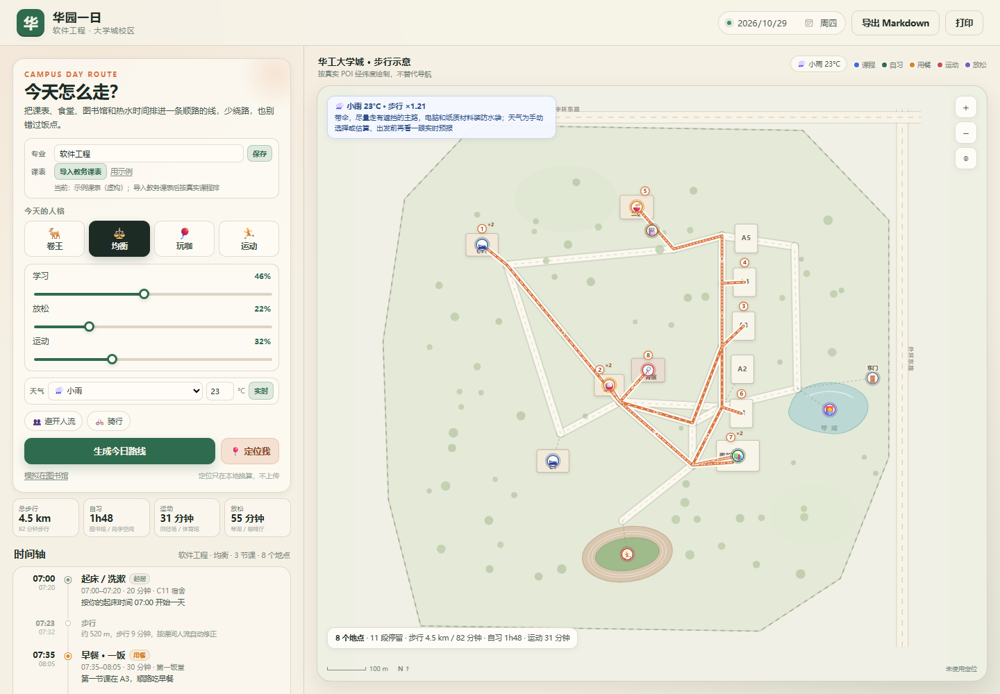

# 华园一日路线（huayuan-campus-route）

完整使用说明（页面按钮、CLI 参数、常见问题）见 [`USAGE.md`](USAGE.md)。

## 这个技能做什么

把**某一天的课表**和**校园开放时间**放在一起，排出一条能走通的线：

- 固定课程不动，按教室所在楼栋（A1–A5）串起教学区；
- 早餐/午餐/晚餐按“离下一节课最近”选一饭或二饭；
- 自习排进图书馆（07:30–23:00）或 C11 架空层尚学空间；
- 运动排进田径场（06:00–22:30）或东区体育馆；
- 洗澡卡在热水 12:00–14:00、17:00–00:00 内，并在门禁前回宿舍；
- 睡觉设为 `00:00` 或次日凌晨时，按当天 `24:00` 封口；不会生成“00:00 从宿舍出发”或零点睡眠块；
- 每段路都算步行/骑行时间，课间人流、天气、高峰会加时；
- 用户的「卷 / 玩 / 运动」权重决定空档怎么分；
- 天气会改路线：雨/大雨把运动改体育馆、放松改室内，高温/污染取消露天跑步，寒冷加热身提醒，并给出带伞/防晒/口罩提示；
- 页面可填写**专业**（只存本机），并导入教务 `jw-timetable.json`；导入时校验校区、课程数、缺时间和当前教学周；
- **考试与待办**：导入考试 JSON（或载入虚构示例）后，按专业筛选并按 T-14/T-7/T-3/T-1 拆复习任务；手动待办可填截止、预计耗时、优先级；任务会标进当天自习块，页面开着时可开启截止前 1 小时提醒。

坐标用 GCJ-02，地点来自地图 POI 检索；**地图是示意图**，不是导航底图。


雨天时运动会自动改到体育馆、放松改到室内：



填入专业并导入课表后，顶部状态会显示课程数和教学周（下图为示例数据）：


考试与待办：导入考试后自动拆复习任务，也可以手动加待办（下图为虚构示例考试）：


## 什么时候用

| 场景 | 是否调用 |
|---|---|
| 「今天怎么走 / 排一条从宿舍到教室的路线」 | ✅ |
| 「上完课顺路去哪个饭堂 / 图书馆闭馆前怎么安排」 | ✅ |
| 「帮我按卷王 / 玩咖 / 运动模式排一天」 | ✅ |
| 「我在图书馆，接下来怎么走」+ 手机定位 | ✅ |
| 只问「我现在该干什么」 | ❌ 先用 `now.js`，要路线再加本技能 |
| 五山校区 / 广州国际校区课程 | ❌ 明确说明只覆盖大学城，不硬套 |
| 未初始化、课表未读取 | ⚠️ 可用 `--demo` 演示，但必须说明是样例 |

## 怎么用

在包根目录执行：

```powershell
# 1) 离线演示（虚构课表，不登录）
node skills\huayuan-campus-route\scripts\day-route.js --demo --date 2026-10-29 --preset balanced

# 2) 用已经读到的教务课表和偏好排
node skills\huayuan-campus-route\scripts\day-route.js `
  --timetable huayuan-output\<时间戳>\jw-timetable.json `
  --preferences "%USERPROFILE%\.workbuddy\huayuan-schedule-butler\preferences.json" `
  --major 软件工程 --date 2026-10-29 --preset sport

# 3) 自定义权重（不传 preset 时生效）
node skills\huayuan-campus-route\scripts\day-route.js --demo --study 0.6 --play 0.1 --sport 0.3

# 4) 从手机定位出发（浏览器定位是 WGS-84，脚本会换算成 GCJ-02）
node skills\huayuan-campus-route\scripts\day-route.js --demo --gps 23.0469,113.4054,wgs84

# 5) 天气 / 骑行 / 高峰
node skills\huayuan-campus-route\scripts\day-route.js --demo --weather rain --temp 23 --mode bike --traffic peak
node skills\huayuan-campus-route\scripts\day-route.js --demo --weather heat --temp 35

# 6) 考试复习 + 手动待办
node skills\huayuan-campus-route\scripts\day-route.js --demo --major 软件工程 --exams exams.json
node skills\huayuan-campus-route\scripts\day-route.js --demo --tasks tasks.json
```

常用参数：

| 参数 | 说明 |
|---|---|
| `--date YYYY-MM-DD` | 排哪一天，默认今天 |
| `--preset balanced\|grind\|play\|sport` | 画像：均衡 / 卷王 / 玩咖 / 运动 |
| `--study/--play/--sport` | 覆盖权重，0–1，会归一化 |
| `--timetable <json>` | 教务课表；不传则找最新 `huayuan-output/*/jw-timetable.json`，再退回 demo |
| `--preferences <json>` | 作息偏好；不传则用 `%USERPROFILE%\.workbuddy\...\preferences.json` |
| `--major <专业>` | 写入日程元数据，只影响展示，不改变课表读取 |
| `--exams <json>` | 考试安排；按 `--major` 筛选并生成 T-14/T-7/T-3/T-1 复习任务 |
| `--tasks <json>` | 手动待办；合并进当天自习块 |
| `--week N` | 按教学周过滤课程（课表里有 `weeks` 时生效） |
| `--dorm c11\|c1` | 宿舍起点，默认 C11 |
| `--gps lat,lng[,wgs84\|gcj02]` | 定位起点；默认按 wgs84 处理 |
| `--mode walk\|bike` | 步行 / 骑行，默认步行 |
| `--weather clear\|cloudy\|rain\|storm\|heat\|cold\|polluted` | 天气画像，会改变运动/放松地点与步行时间 |
| `--temp 23` | 温度；≥33°C 自动按高温处理，≤8°C 按寒冷处理 |
| `--precip 2` / `--aqi 180` | 降水量 / 空气质量，用于雨天与污染判断 |
| `--weather-json <json>` | 用文件提供天气（可接实时天气脚本或手写） |
| `--rain` | 旧参数，等价于 `--weather rain` |
| `--traffic auto\|peak\|clear` | 人流/路况系数 |
| `--output-dir <dir>` | 产物目录 |

## 产物

默认写到 `huayuan-output/route-<日期>-<时间>/`：

- `day-route.json`：结构化日程（`blocks` / `legs` / `stops` / `route` / `warnings` / `validation`）
- `day-route.md`：可直接贴进笔记软件的时间轴与依据

终端会打印：

```
DAY_ROUTE_OK:<json 路径>
SUMMARY: 2026-10-29 星期四 · 均衡 · ☁️ 多云 26°C · 8 站 · 步行 4859 m / 71 分钟 · 自习 110 分钟 · 运动 31 分钟 · 放松 55 分钟 · 任务 0 分钟
```

## 可视化页面

不需要构建、不需要起服务器，直接用浏览器打开：

```
skills\huayuan-campus-route\public\index.html
```

页面里可以：

- 填写**专业**并保存到本机，或导入教务 `jw-timetable.json`（会校验校区、课程数、周次；五山会被拒绝）；
- 展开「考试与待办」：导入考试 JSON 或载入示例，自动生成复习任务；手动加待办；开启页面提醒；
- 切日期、四个画像、三条权重滑杆；
- 选天气/温度，或点「实时」用 Open-Meteo 取当天天气（无需 Key，失败保留手动值；URL 加 `?live=1` 自动取）；
- 开「避开人流 / 骑行」；
- 点「设备定位」使用当前浏览器所在电脑的系统定位，或点「模拟在图书馆」；
- 点地图上的地点看开放时间、说明和真实地图链接；
- 导出 Markdown 或打印时间轴。

定位只在浏览器本地换算，不上传、不写文件；被拒绝或超时会明确提示，不会假装定位成功。天气来自 Open-Meteo 或手动选择，页面和 Markdown 都会标明来源。

## 数据来源与可信度

| 数据 | 来源 | 可信度 |
|---|---|---|
| 图书馆 07:30–23:00 | 图书馆官网《开馆时间》 | 官方 |
| 热水 12:00–14:00、17:00–00:00 | 2026 级大学城校区通关指南（学生工作部） | 官方 |
| 门禁周日至周四 23:00 / 周五周六 23:30 | 同上 | 官方 |
| 一饭/二饭/体育馆/咖啡厅时段 | 常见供餐与开放时段 | **参考，以现场为准** |
| POI 坐标 | 360 地图 POI（GCJ-02） | 标 `high` 的可核对；`medium/low` 仅示意 |
| 天气 | 手动选择，或 Open-Meteo 实时预报 | 实时/估算都会标注，出发前复核 |
| 步行时间 | 示意路网距离 ÷ 步速 × 人流/天气系数 | 估算，不是导航 |

页面和 Markdown 都会保留这些标注；不要把 `approx` 说成官方时间。

## 集成到专家回答

用户明确要路线时，先跑脚本，再用「结论 → 1–3 条依据 → 一个下一步」回答，例如：

> 今天 8 个地点、步行约 4.9 km。下午 15:53 去图书馆自习 30 分钟，16:31 去田径场跑 31 分钟，17:20 一饭晚饭；晚上 18:18 回图书馆自习到 19:51，19:59 去图书馆咖啡厅坐到 20:54，22:10 回 C11 洗澡。要看地图就说「打开路线页面」。

不要在没有跑脚本时编造具体分钟；不要把五山课表硬套到大学城。下雨/高温时先报“因天气改室内/取消露天运动”，再给时间轴。

## 不做什么

- 不做真实导航、不申请高德/腾讯 API Key、不读取实时路况；
- 不承诺 Open-Meteo 一定可用；取不到就保留手动天气，不假装是实时；
- 不承诺能直接登录教务考试系统：真实考试需要导入 `exams.json`；内置考试是**虚构示例**，不是真实安排；
- 不做自动签到、不代交作业、不改学校数据；
- 不覆盖五山/广州国际校区（会返回 `CAMPUS_UNSUPPORTED`）；
- 不把 `medium/low` 坐标当精确位置；
- 不在用户没同意时读取定位。

## 回归

```powershell
node skills\huayuan-campus-route\test\check-route.js
```

31 项断言：数据连通、教务课表导入（大学城/五山/坏 JSON/空课程/缺校区）、专业元数据与偏好、考试按专业筛选与 T-14/T-7/T-3/T-1 拆分、手动待办去重与自习块标注、任务状态、课程保留、时间不重叠、热水/门禁、四类画像差异、周末、GPS 校内外、WGS→GCJ、雨天/骑行、雨天改体育馆、大雨/高温/污染室内化、天气写进 Markdown、开放时间、咖啡厅合并、五山拒绝、未知教室、Markdown 导出。
